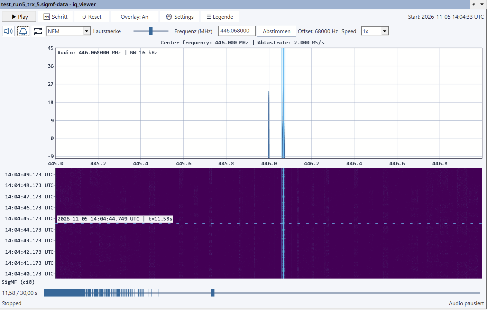

# IQ Data Viewer (wav, hackrf, vita49, sigmf) for Total Commander

A Total Commander WLX64 Lister plugin that displays HackRF IQ data files
with real-time PSD spectrum and waterfall spectrogram visualization.



## Features

- **PSD Spectrum**: FFT-based power spectral density with Hann window and segment averaging
- **Waterfall Spectrogram**: Scrolling waterfall display with Viridis colormap, correctly
  showing all three playback phases (fixed start window → scrolling → fixed end window)
- **CUDA Acceleration**: Automatic GPU acceleration via cuFFT with CPU fallback
- **OpenGL Rendering**: Hardware-accelerated rendering with MSAA anti-aliasing
- **Optional Audio**: Native Pascal AM/NFM/WFM/CW demodulation, click/typed tuning,
  volume, speed, pause/seek and loop; 48 kHz mono through Windows waveOut.
  Audio is off by default. No Python runtime or audio codec packages are needed.
- **Playback Controls**: Play/Stop, Step (advance one waterfall row), Reset, position
  slider for scrubbing through files
- **Settings Dialog**: Adjustable sample rate, center frequency, FFT sizes, dB range
- **Signal Overlay**: Toggleable per-signal markers with labels above the spectrum;
  runs of consecutive frequency-hopping signals (`comment=Hopper N/M, Folge X/Y`) are
  collapsed into a single bracket instead of one label per hop
- **Frequency Cursor & Tooltip**: The status bar shows the frequency under the mouse
  cursor; hovering near a signal marker shows its full metadata (name, modulation,
  timing, parameters, comment) in a tooltip
- **Signal Legend**: Dialog listing every signal from the metadata (index, name,
  modulation, sequence/timing, frequency, offset, amplitude, parameters, comment)
- **Metadata Support**: Reads `.txt` sidecar files for sample rate, center frequency, signal annotations
- **SigMF Recordings**: Open `.sigmf-meta` or `.sigmf-data` with automatic
  datatype, sample-rate, center-frequency and annotation loading (details below).
- **Thumbnail Preview**: Quick PSD+waterfall preview in TC file panels
- **HiDPI-aware dialogs**: Settings and Legend dialogs scale with the monitor's DPI
- **Multiple Formats**: `.iq`, `.raw`, `.cs8` (int8), `.cs16` (int16), `.cf32` (float32),
  `.sdriq` (SDRAngel, CRC-checked 28-/32-byte headers), VITA-49/VRT, and RIFF/WAVE
  (2-channel I/Q). Format is detected from an `output_format=` hint in the
  sidecar `.txt`, file-content sniffing (RIFF magic, VRT packet structure), or
  the file extension as a last resort.

## Building

### Requirements

- **Lazarus IDE** 2.2+ with Free Pascal Compiler 3.2+
- **Target**: x86_64-win64 (64-bit Windows)
- No LCL required — pure Win32 API + OpenGL

### Build Steps

1. Open `iq_viewer.lpi` in Lazarus IDE
2. Select build mode **Release** (or **Debug** for development)
3. Build → `Compile` (Ctrl+F9)
4. Output: `iq_viewer.wlx64`

### Command Line Build

```bash
lazbuild --build-mode=Release iq_viewer.lpi
```

Or directly with FPC:

```bash
fpc -MObjFPC -dRELEASE -O3 -Xs -XX -CX \
    -Twin64 -Px86_64 \
    iq_viewer.lpr
```

Rename the output `.dll` to `.wlx64`.

## Installation

### Automatic

1. Open `wlx_iqviewer.zip` in Total Commander
2. TC will install the plugin automatically

### Manual

1. Copy `iq_viewer.wlx64` to a permanent location
2. In TC: Configuration → Options → Plugins → Lister Plugins
3. Click "Add" and select `iq_viewer.wlx64`
4. Detection string: `EXT="IQ" | EXT="RAW" | EXT="CF32" | EXT="CS8" | EXT="CS16" | EXT="SDRIQ" | EXT="SIGMF-META" | EXT="SIGMF-DATA" | EXT="VRT" | EXT="V49" | EXT="VITA49" | EXT="WAV"`

The installation archive contains the Win32 and Win64 plugins and the matching
`pluginst.inf`. Existing installations may still have an older detection string
stored in Total Commander. Update that string in the Lister plugin settings when
upgrading; replacing the DLL alone does not update the stored configuration.
WAV auto-detection includes supported I/Q recordings; plugin order can affect
which viewer Total Commander selects for other WAV files.

## Playback keys and time display

With the viewer, spectrum, toolbar buttons or position slider focused:
- **Space** starts/stops playback without resetting the position. Holding Space
  does not repeatedly toggle playback.
- **Left / Right** jump back/forward by five seconds, clamped to the recording.
  Playing audio is flushed and restarted at the new position; paused stays paused.
- **Esc** requests closing through Total Commander's normal Lister close path.

Frequency editing and combo-box selection retain their native Space/arrow keys;
volume arrows still adjust volume. Esc first closes an open combo dropdown.
Enter applies the frequency or activates a focused button (including icon toggles).
These shortcuts do not change the initial focus policy for QuickView.

Elapsed / total time is immediately to the left of the playback slider. Spectrum
and waterfall share one measured gutter for dB/time labels; the redundant blank
left strip is removed, giving both plots more horizontal room.

## Appearance and high DPI

Light and dark mode share one palette across controls, settings, signal legend,
status labels and plots. Dark mode uses neutral blue/gray surfaces, light text
and cyan accents. Audio status sits at the bottom right. The first toolbar row
shows the recording start date/time at the right, independently of playback or
seeking; recordings without an absolute timestamp say so rather than using file
dates. Long hints use an ellipsis instead of taking an extra row.

The speaker, filter-band and repeat icons form one group: audio activation,
demodulation-band display and loop playback. Native accessible names, keyboard
operation, checked state and tooltips describe their functions. Volume stays
near the start of the audio controls. Labels are vertically centered with their
fields; the compact frequency field is measured for exactly four integer digits,
the decimal separator and six fractional digits, plus normal edit padding. Speed stays inline whenever space permits. Controls wrap only when
needed; very short windows provide a vertical scrollbar for access.

The spectrum header has no background badge or empty row underneath. It spells
out Abtastrate (sample rate), in MS/s, instead of SR. This is the number of samples
per second, not the demodulation bandwidth. Plot labels and timestamps use an
antialiased outline font rasterized at the current DPI into a cached alpha atlas,
rather than enlarged 5x7 glyphs.

Optional configuration in `iq_viewer.ini` beside the plugin:

```ini
[Appearance]
Theme=auto
ScalePercent=0
```

`Theme=auto` follows Total Commander's initial theme and subsequent `lc_newparams`
notifications, including switching back to light mode. Standalone viewers fall
back to the Windows application theme. `Theme=dark` or `Theme=light` fixes the
appearance independently of the host. Unknown values use `auto`.

`ScalePercent=0` follows the current window DPI automatically. Values from 100 to
300 set an explicit percentage (for example 150 or 200). Fonts, controls, spacing,
status areas, diagram text and mouse coordinates scale together. The plugin does
not change Total Commander's process DPI awareness. DPI notifications update the
viewer and settings/legend dialogs. Actual monitor behavior also depends on the
host's DPI awareness.

The adjacent INI takes precedence over the INI path supplied by Total Commander.
Values support quotes and inline `;` / `#` comments. The plugin reads these
settings when opening a viewer and never writes them. `iq_viewer_default.ini`
is the complete reference template; it is not read at runtime.

## Usage

1. Select an IQ file in Total Commander
2. Press **F3** (Quick View) or **Ctrl+Q** (Lister panel)
3. Use the toolbar buttons:
   - **▶ Play**: Start/stop playback through the file
   - **⏭ Schritt**: Advance by one waterfall row (single-step, e.g. while paused)
   - **↺ Reset**: Jump back to the beginning
   - **Overlay: An/Aus**: Show/hide the signal markers and labels
   - **⚙ Settings**: Open the settings dialog
   - **☰ Legende**: Open the signal legend (disabled if the file has no metadata)
4. Drag the position slider to scrub through the file
5. Move the mouse over the spectrum or waterfall to read the frequency under
   the cursor (bottom-right status field) and, when near a signal marker, see
   its details in a tooltip

## Optional audio listening

The listening controls follow the player in
`Radio/Programme Python/HackRF_SigMF_Windows` (`viewer_gui.py`, `audio_playback.py`,
`dsp.py`). The DSP and output are implemented locally in Pascal. The local FIR
building blocks were adapted from `wfx_spektrum/engine/uFir.pas`; neither project
is a runtime dependency.

1. Enable **Audio aktiv** and select **AM**, **NFM**, **WFM** or **Morse (CW)**. NFM is the default;
   FM is the family name, so there is no separate ambiguous FM menu item.
2. Enter the absolute frequency in **Frequenz (MHz)** and press Enter or
   **Abstimmen**, or click the spectrum/waterfall to tune on a 1 kHz raster.
   The offset from the capture center and an orange tuning marker are shown.
   Without a known capture center, frequency is relative to baseband zero.
   **Audiobandbreite** optionally shades the selected demodulation channel in
   both plots: AM 10 kHz, NFM 16 kHz, WFM 180 kHz, CW 200 Hz, centered on the tuned frequency.
   This is the receiver's RF channel width, not the demodulated audio low-pass.
   In the spectrum the shading is behind the curve; in the waterfall it is
   translucent. The numeric width is shown next to the tuning label. Bands
   extending outside the displayed capture are clipped. This per-viewer switch
   defaults off and works independently of audio playback, including paused
   previews; toggling it only redraws and never starts/restarts the decoder.
3. **Play / Pause** starts or pauses listening. The slider seeks; **Reset**
   returns to the beginning. Seeking, retuning and mode/speed changes discard
   the previous audio buffers before starting the new decoder at that position.
4. Adjust **Lautstaerke** (default 50%). **Speed** offers 0.25x, 0.5x, 1x, 2x and
   4x; speed changes AM/FM pitch as in the reference player, without time stretching.
   CW keeps the centered 860 Hz tone while changing the Morse timing.
   **Loop** repeats at EOF. Step/reset/settings keep the existing viewer controls.

Audio defaults off, speed to 1x and loop off for each viewer. These controls are
per-window session settings; no new INI keys or production INI files are used.
Controls wrap on narrow windows and use the window DPI. With audio disabled,
playback uses the existing visual timer (with the selected playback speed).

AM uses envelope detection; NFM uses a 2.5 kHz discriminator-deviation profile and
16 kHz channel filter; WFM uses 75 kHz deviation, a 180 kHz channel and European
50 microsecond de-emphasis. AM uses a 10 kHz channel. Channel selection must fit
inside the captured band; invalid rate/frequency combinations are reported.
**Morse (CW)** uses a nominal 200 Hz receiver filter (+/-100 Hz around tuning)
followed by an 860 Hz beat-frequency oscillator at the 48 kHz output rate. The
centered tone stays at 860 Hz for all speed choices; a small tuning error shifts
its pitch. This makes a received keyed carrier audible and preserves its keying;
it does not generate a continuous tone without a signal and does not recognize
letters or display decoded Morse text. Capture rates of at least 8 kS/s are
required in this mode. A low intermediate rate gives the narrow FIR sufficient
selectivity; filter transitions and startup/ringing remain finite, not brick-wall.
The optional bandwidth label shows **200 Hz**, including spectrum background and
waterfall shading. At wide capture spans this narrow band can be only a pixel.

WFM is **mono**, with an approximately 15 kHz audio band. This is not a stereo,
RDS, SSB, digital-voice or automatic-squelch decoder. No analytic/Hilbert conversion
of real-only RF recordings is performed: listening is intended for complex I/Q.
Audio follows stored samples; timestamp gaps do not insert synthetic silence.

The stateful chain performs anti-alias decimation, NCO tuning, channel filtering,
demodulation, DC removal and fractional polyphase resampling to 48 kHz. It keeps
filter/phase state between blocks and supports non-integer SDR rates. A separate
worker owns its file reader, demodulator and Windows output; plotting does not
produce the audio. Blocks are limited to 65,536 IQ samples. Output is mono PCM16
in 20 ms packets, prefilled to about 400 ms with at most 24 queued packets plus
one bounded decode block. Slow decoding triggers rebuffering rather than dropping
recorded audio or caching the whole recording. These bounds do not promise real
time at every capture rate or speed on every computer.

The displayed source position follows consumed audio frames. Pause preserves the
queue; stop/reconfiguration/close reset it. Device/read errors are shown in the
listening status and stop playback. Volume affects newly submitted buffers, so
changes may take the existing output reserve to become audible. The default
Windows output device is used. Tests open real output muted; hardware listening
quality and actual Total Commander integration require user testing.

Worker shutdown happens during normal viewer close. The decoder holds an extra
DLL reference from before thread start until after joining; no joins, audio
callbacks, posted cleanup or window destruction were added to finalization.
The output polls completed waveOut headers with CALLBACK_NULL. If a broken driver
refuses reset/unprepare/close, small driver-owned buffers are deliberately retained
rather than freed while still referenced. Normal close/reload paths are tested;
this does not prove complete leak freedom for faulty hardware drivers.

Audio tests are part of `test/run_tests.ps1`: synthesized tone/adjacent-channel
DSP tests, paced-null and muted-device player tests, native controls/seek/loop/
multiple-listener/close tests and relocated DLL reload, followed by all format
and unload regressions. UI BMP and GL PPM captures are saved under `test/32` and
`test/64`. The test-only null output is per player and is never selected by the
plugin UI.

Output API reference: [Microsoft pause/reset/restart documentation](https://learn.microsoft.com/en-us/windows/win32/multimedia/stopping-pausing-and-restarting-playback).

## Settings Dialog

| Parameter | Default | Description |
|-----------|---------|-------------|
| Sample Rate | 2 MHz | Sample rate in Hz |
| Center Freq | 0 | Center frequency in Hz (0 = baseband) |
| PSD NFFT | 2048 | FFT size for PSD display |
| WF NFFT | 256 | FFT size for waterfall rows |
| WF History | 150 | Number of waterfall rows visible |
| WF Overlap | 0.0 | Overlap between waterfall windows (0..0.95) |
| Min dB | -10 | Minimum of color/magnitude scale |
| Max dB | 45 | Maximum of color/magnitude scale |
| Chunk (sec) | 0.2 | Duration of each playback chunk |
| Avg Segments | 1 | Number of FFT segments averaged for PSD |

## Metadata Sidecar Files

Place a `.txt` file next to the IQ file with the same base name:

```
sample_rate_hz=2000000
center_freq_hz=433920000
output_format=hackrf
signals=
  [0] name=beacon comment=test signal  modulation=fm offset_hz=0 amplitude=0.5 loop_mode=false params={"deviation": 5000}
  [1] modulation=am offset_hz=50000 amplitude=0.3 params={}
```

The plugin reads `sample_rate_hz` and `center_freq_hz` automatically and
shifts the frequency axis accordingly. `output_format=` (`hackrf` / `sdrangel`
/ `sda-wav`) is used as the primary hint for file-format detection. Per
signal, `name`, `comment`, `loop_mode`, `repeat`, `pause`, `delay`, and
`duration` are also parsed (in addition to `modulation`, `offset_hz`,
`amplitude`, `params`) — note `comment=` must be followed by two spaces
before the next key.

If a signal's `comment=` is exactly `Hopper N/M, Folge X/Y`, it's treated as
part of a frequency-hopping sequence. Consecutive signals matching that
pattern (starting fresh whenever `N=1` and `X=1`) are grouped into a single
bracket overlay spanning their frequency range, instead of one label per hop.

## SigMF Support

Keep the `.sigmf-meta` JSON and its matching `.sigmf-data` file together;
open either file with F3. The metadata is authoritative for SigMF recordings,
including thumbnails; legacy `.txt` sidecars keep their existing behavior for
other formats. Format rules follow the [official SigMF specification](https://sigmf.org/).

Supported single-channel core datatypes:

- Complex (`c`) and real (`r`) samples; real input uses Q = 0.
- Signed/unsigned 8-, 16- and 32-bit integers, and 32-/64-bit floats.
- `_le` and `_be` byte order for all multibyte types.

Integer components are normalized by 2^(bits-1); unsigned values are centered
at their midpoint. Float input is converted to the viewer's Single precision;
non-finite values and values outside the Single range are rejected.
Sample access seeks directly into the dataset and decodes in bounded blocks.

`core:sample_rate` controls time and frequency scaling; when absent the viewer
keeps its existing 2 MHz default (annotation timing then remains unspecified).
Capture `core:frequency` sets the frequency axis; if supplied, the same frequency
must be present in every capture and the first capture must start at the first
dataset sample. Annotation labels and
descriptions appear in the existing legend/tooltips, frequency bounds become
a marker at their midpoint, and sample start/count become delay/duration when
a sample rate is present. The original annotation JSON is kept in Parameters.
`core:offset` is subtracted from absolute sample indices.

Non-conforming datasets can be opened via metadata using `core:dataset` (a
filename in the same directory), capture `core:header_bytes`, and global
`core:trailing_bytes`. Headers are skipped even when a read crosses captures.

Limitations: one channel and a fixed capture frequency; changing frequencies,
required extensions, metadata-only recordings, unsupported/malformed datatypes,
missing companion files and incomplete final samples are rejected. No extension
namespaces are interpreted; optional extensions are ignored. SigMF collections
and `.sigmf` tar archives must be handled/extracted separately. Frequency bands
are represented as point markers in the existing UI.

### Format regression tests

Run `powershell -ExecutionPolicy Bypass -File test/run_tests.ps1` from this
project. The script generates synthetic fixtures, builds both release targets,
runs checked model tests and native export/thumbnail tests, then exercises the
shared native unload host with SigMF metadata/data, raw, VRT and Broadcast Wave input.
Sparse fixtures larger than 4 GiB check sample counts and reads beyond the
32-bit file-position boundary. Framebuffer snapshots are saved as PPM files. Logs and
test executables are kept under `test/32` and `test/64`; the script does not
install plugins or change Total Commander configuration.

## VITA-49/VRT decoding

Open `.vrt`, `.v49` or `.vita49`; these extensions and `.wav` are now included
in the Total Commander detection string. Existing content detection and legacy
`output_format=sda-wav` hints remain available.

The reader indexes packet headers using 64-bit file offsets and sample counts,
then seeks to requested payloads. It does not concatenate or fully decode the
recording in memory. Index memory grows with packet count; data reads and sample
conversion use bounded blocks. A complete header scan still happens at opening.

The context payload-format field selects real or Cartesian complex samples,
signed/unsigned normalized or non-normalized fixed point (up to 32 bits), and
IEEE half/single/double precision. Byte-aligned 8/16/24/32-bit fixed point and
big-endian link-efficient packed widths are supported. Item and packing widths
must match; processing-efficient widths must divide a 32-bit word (or be 64).
Non-normalized fixed point uses the specified fraction size. Format changes
between packets are handled. Legacy context-free recordings retain the Int16 IQ
assumption. Little-endian recordings are supported as a compatibility variant;
standard VRT transmission is big endian.

Context sample rate controls the axes and duration. RF reference frequency plus
RF offset and IF band offset controls the center frequency. Bandwidth, receiver
gain and reference level appear in the plot status and follow the current
packet. Spectral-inversion flags conjugate Q. Gain/reference metadata are shown
as receiver information; the PSD remains relative power, not a calibrated dBm
measurement. Explicit legacy TXT sample-rate/frequency overrides still win.

Checks cover packet/header/trailer bounds, context-field lengths, sequence
continuity, stream association, valid-data/sample-loss flags, payload alignment,
format descriptors and decoded finite sample values. Truncated/unsupported input
raises an error instead of silently returning a partial recording. A read error
during playback stops playback and reports the error in the status bar.

This is a single-stream reader. Changes in rate or center frequency are rejected
rather than drawing incompatible samples on one fixed axis. Exponent formats,
polar data, unequal item/packing widths, repeated/vector/tagged payloads, extra
CIF groups, extension/control/spectral packets, 49.1 framing and PCAP containers
are not implemented.

## Recording time marks

Waterfall ticks use supplied recording clocks, including timestamp changes at
capture/packet boundaries. The playhead also shows date and clock basis. Files
without a usable timestamp keep relative seconds. Data rows remain compact in
sample order: timestamp jumps change labels; missing samples are not invented.

- **VRT:** integer UTC/GPS/other timestamps and picosecond/sample-count fractions;
  context timestamps serve as anchors when data timestamps are absent. GPS stays
  labeled GPS, without guessing a UTC leap-second correction. An arbitrary
  free-running counter has no known conversion to clock time and keeps relative
  labels. Other epochs are explicitly marked OTHER.
- **SigMF:** capture `core:datetime` including fractional seconds and timezone
  offsets, combined with `core:sample_start` and `core:offset`.
- **SDRAngel:** header start timestamp (seconds for older recordings, milliseconds
  for current recordings), center frequency, rate and sample width. Both header
  layouts are CRC checked. 24-bit samples use 32-bit storage with 23 fraction bits.
- **Broadcast Wave:** `bext` origination date plus 64-bit time reference divided by
  sample rate. BWF has no timezone field, so the recorder clock is labeled REC.
  Ordinary raw and WAV files do not inherently contain an absolute timestamp.

## WAV and general input validation

WAV uses the declared format tag: two-channel PCM 8/16/24/32 and IEEE float 32/64,
including matching WAVEFORMATEXTENSIBLE subformats. PCM8 is unsigned and centered.
RF64/ds64 supports data chunks beyond 4 GiB. Unknown chunks are skipped by seeking;
`fmt`, `data`, `bext`, alignment, chunk sizes/padding and RIFF/RF64 lengths are
validated. Compressed formats, multiple data chunks, unsupported valid-bit layouts
and RF64 extra chunk-size tables are rejected.

Raw input rejects incomplete I/Q pairs. All readers reject non-finite/out-of-range
floating-point samples when decoded. SDRIQ checks header CRC and sample size.
Readers also detect dataset-size changes after opening; these checks do not detect
same-size edits. Sample validation is lazy: corruption outside the requested
portion may only be reported when that portion is read.

Implementation references: [VITA FAQ](https://www.vita.com/page-1855471),
[Keysight VITA format notes](https://helpfiles.keysight.com/csg/89600B/Webhelp/Subsystems/sharing/content/vita49_file_format.htm),
[Wireshark field definitions](https://www.wireshark.org/docs/dfref/v/vrt.html),
[SDRAngel header](https://github.com/f4exb/sdrangel/blob/master/sdrbase/dsp/filerecord.h).

## CUDA Support

The plugin dynamically loads NVIDIA CUDA libraries at startup:
- `cudart64_12.dll` (fallback to versions 11, 10)
- `cufft64_11.dll` (fallback to version 10)

If CUDA is unavailable, all DSP computation runs on CPU using a
Cooley-Tukey radix-2 FFT implementation. The status bar shows `[GPU:...]`
or `[CPU]` to indicate which backend is active.
