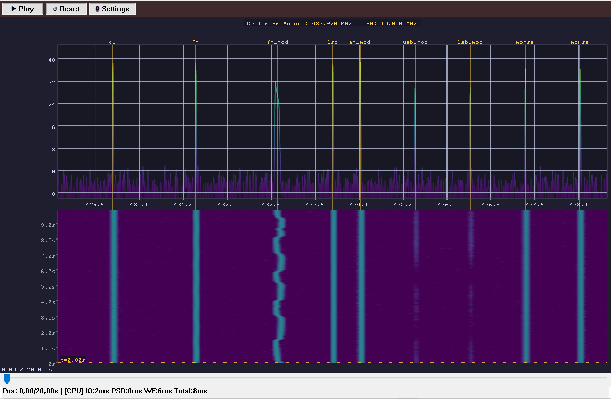

# IQ Viewer WLX — HackRF IQ Data Viewer for Total Commander

A Total Commander WLX64 Lister plugin that displays HackRF IQ data files
with real-time PSD spectrum and waterfall spectrogram visualization.

## Features

- **PSD Spectrum**: FFT-based power spectral density with Hann window and segment averaging
- **Waterfall Spectrogram**: Scrolling waterfall display with Viridis colormap, correctly
  showing all three playback phases (fixed start window → scrolling → fixed end window)
- **CUDA Acceleration**: Automatic GPU acceleration via cuFFT with CPU fallback
- **OpenGL Rendering**: Hardware-accelerated rendering with MSAA anti-aliasing
- **Playback Controls**: Play/Stop, Step (advance one waterfall row), Reset, position
  slider for scrubbing through files
- **Settings Dialog**: Adjustable sample rate, center frequency, FFT sizes, dB range
- **Signal Overlay**: Toggleable per-signal markers with labels above the spectrum;
  runs of consecutive frequency-hopping signals (`comment=Hopper N/M, Folge X/Y`) are
  collapsed into a single bracket instead of one label per hop
- **Frequency Cursor & Tooltip**: The status bar shows the frequency under the mouse
  cursor; hovering near a signal marker shows its full metadata (name, modulation,
  timing, parameters, comment) in a tooltip
- **Signal Legend**: Dialog listing every signal from the metadata (index, name,
  modulation, sequence/timing, frequency, offset, amplitude, parameters, comment)
- **Metadata Support**: Reads `.txt` sidecar files for sample rate, center frequency, signal annotations
- **Thumbnail Preview**: Quick PSD+waterfall preview in TC file panels
- **HiDPI-aware dialogs**: Settings and Legend dialogs scale with the monitor's DPI
- **Multiple Formats**: `.iq`, `.raw`, `.cs8` (int8), `.cs16` (int16), `.cf32` (float32),
  `.sdriq` (SDRAngel, int16 LE with 28-byte header), VITA-49/VRT, and RIFF/WAVE
  (2-channel I/Q). Format is detected from an `output_format=` hint in the
  sidecar `.txt`, file-content sniffing (RIFF magic, VRT packet structure), or
  the file extension as a last resort.

## Building

### Requirements

- **Lazarus IDE** 2.2+ with Free Pascal Compiler 3.2+
- **Target**: x86_64-win64 (64-bit Windows)
- No LCL required — pure Win32 API + OpenGL

### Build Steps

1. Open `iq_viewer.lpi` in Lazarus IDE
2. Select build mode **Release** (or **Debug** for development)
3. Build → `Compile` (Ctrl+F9)
4. Output: `iq_viewer.wlx64`

### Command Line Build

```bash
lazbuild --build-mode=Release iq_viewer.lpi
```

Or directly with FPC:

```bash
fpc -MObjFPC -dRELEASE -O3 -Xs -XX -CX \
    -Twin64 -Px86_64 \
    iq_viewer.lpr
```

Rename the output `.dll` to `.wlx64`.

## Installation

### Automatic

1. Double-click `pluginst.inf` in Total Commander
2. TC will install the plugin automatically

### Manual

1. Copy `iq_viewer.wlx64` to a permanent location
2. In TC: Configuration → Options → Plugins → Lister Plugins
3. Click "Add" and select `iq_viewer.wlx64`
4. Detection string: `EXT="IQ" | EXT="RAW" | EXT="CF32" | EXT="CS8" | EXT="CS16" | EXT="SDRIQ"`

`.wav` and VITA-49/VRT files (which typically don't use a dedicated
extension) aren't in the auto-detection string, since `.wav` is too generic
to safely hijack from other TC lister plugins. They still open correctly if
you point TC at this plugin explicitly for those files (e.g. a user-defined
extension association, or "open with" in TC's lister).

## Usage

1. Select an IQ file in Total Commander
2. Press **F3** (Quick View) or **Ctrl+Q** (Lister panel)
3. Use the toolbar buttons:
   - **▶ Play**: Start/stop playback through the file
   - **⏭ Schritt**: Advance by one waterfall row (single-step, e.g. while paused)
   - **↺ Reset**: Jump back to the beginning
   - **Overlay: An/Aus**: Show/hide the signal markers and labels
   - **⚙ Settings**: Open the settings dialog
   - **☰ Legende**: Open the signal legend (disabled if the file has no metadata)
4. Drag the position slider to scrub through the file
5. Move the mouse over the spectrum or waterfall to read the frequency under
   the cursor (bottom-right status field) and, when near a signal marker, see
   its details in a tooltip

## Settings Dialog

| Parameter | Default | Description |
|-----------|---------|-------------|
| Sample Rate | 2 MHz | Sample rate in Hz |
| Center Freq | 0 | Center frequency in Hz (0 = baseband) |
| PSD NFFT | 2048 | FFT size for PSD display |
| WF NFFT | 256 | FFT size for waterfall rows |
| WF History | 150 | Number of waterfall rows visible |
| WF Overlap | 0.0 | Overlap between waterfall windows (0..0.95) |
| Min dB | -10 | Minimum of color/magnitude scale |
| Max dB | 45 | Maximum of color/magnitude scale |
| Chunk (sec) | 0.2 | Duration of each playback chunk |
| Avg Segments | 1 | Number of FFT segments averaged for PSD |

## Metadata Sidecar Files

Place a `.txt` file next to the IQ file with the same base name:

```
sample_rate_hz=2000000
center_freq_hz=433920000
output_format=hackrf
signals=
  [0] name=beacon comment=test signal  modulation=fm offset_hz=0 amplitude=0.5 loop_mode=false params={"deviation": 5000}
  [1] modulation=am offset_hz=50000 amplitude=0.3 params={}
```

The plugin reads `sample_rate_hz` and `center_freq_hz` automatically and
shifts the frequency axis accordingly. `output_format=` (`hackrf` / `sdrangel`
/ `sda-wav`) is used as the primary hint for file-format detection. Per
signal, `name`, `comment`, `loop_mode`, `repeat`, `pause`, `delay`, and
`duration` are also parsed (in addition to `modulation`, `offset_hz`,
`amplitude`, `params`) — note `comment=` must be followed by two spaces
before the next key.

If a signal's `comment=` is exactly `Hopper N/M, Folge X/Y`, it's treated as
part of a frequency-hopping sequence. Consecutive signals matching that
pattern (starting fresh whenever `N=1` and `X=1`) are grouped into a single
bracket overlay spanning their frequency range, instead of one label per hop.

## CUDA Support

The plugin dynamically loads NVIDIA CUDA libraries at startup:
- `cudart64_12.dll` (fallback to versions 11, 10)
- `cufft64_11.dll` (fallback to version 10)

If CUDA is unavailable, all DSP computation runs on CPU using a
Cooley-Tukey radix-2 FFT implementation. The status bar shows `[GPU:...]`
or `[CPU]` to indicate which backend is active.

## Project Structure

```
iq_viewer.lpr       — DLL entry point with WLX64 exports
iq_viewer.lpi       — Lazarus project file
uGlobals.pas        — Constants, types, dark theme colors
uMetadata.pas       — Sidecar .txt metadata parser
uIQData.pas         — Seekable IQ file loading (int8/int16/float32)
uIQFormats.pas      — Format detection + sdriq/VITA-49/WAV support (TIQSource)
uFFT.pas            — CPU FFT engine (Cooley-Tukey radix-2)
uCudaFFT.pas        — CUDA cuFFT wrapper with dynamic loading
uColormap.pas       — Viridis colormap implementation
uWinGL.pas          — OpenGL/WGL bindings (no LCL)
uGLRenderer.pas     — OpenGL spectrum + waterfall renderer
uViewerForm.pas     — Main viewer window (pure Win32)
uThumbnail.pas      — Thumbnail bitmap generator
pluginst.inf        — TC plugin installation descriptor
```

## License

This project is provided as-is for personal use.
